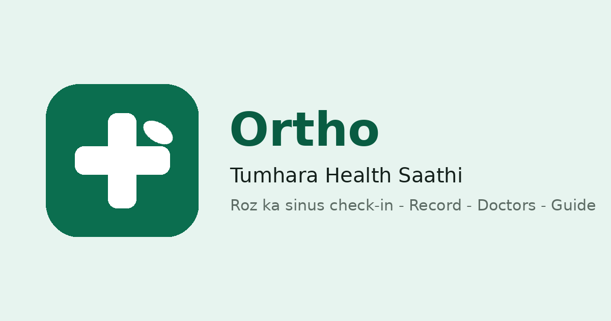

# 🌿 Ortho — Tumhara Health Saathi

**Roz ka sinus check-in, health record, AI se sawal-jawab, photo se dawai ki pehchan, ENT doctors aur sinus guide — ek saaf, shant app me.**

### 🔗 Live Links

| Kya | Link |
|---|---|
| 🌐 **Web app** | https://orthodoctorr.vercel.app |
| 📲 **Android app download page** | https://orthodoctorr.vercel.app/download.html |
| 🤖 **APK (direct)** | https://orthodoctorr.vercel.app/ortho-app.apk |

## Kya hai ye?

Ortho ek **personal health-assistant app (PWA + Android)** hai — allergic sinusitis ke roz ke check-in aur record ke liye shuru hua tha, ab ek **all-in-one health jaankari saathi** ban gaya hai. Phone par install hokar bilkul app ki tarah khulta hai — browser se bhi, Android APK se bhi.

> ⚕️ **Seema (hamesha yaad rahe):** Ortho sirf **jankari aur record** ka saathi hai. Ye **pakka diagnosis nahi** karta aur **personal prescription (dawa ki salah) nahi** deta — wo hamesha doctor ka kaam hai.

## Features

- 💬 **AI chat (asli dimag ke saath)** — koi bhi health sawal khul ke puchho: dawaiyon ki jaankari, aam beemariyan, gharelu upaye, surgery ki basics, kaun sa specialist kab, dental basics, sexual health aur periods ki sehatmand jaankari. Jawab saaf Roman Hinglish me. Chat history account me save rehti hai.
- 📷 **Photo se dawai ki pehchan** — dawai ke packet/strip ki photo bhejo; app pehle **naam confirm** karwata hai, phir batata hai ki ye dawai kis kaam aati hai.
- ✅ **Roz ka check-in** — chat se ya form se: neend, naak band (0–10), sar dard (0–10), padhai par asar, note. Chat aur form **ek hi din ke ek hi record** ko likhte hain; din me ek baar ho jaye to app baar-baar nahi satata.
- 📈 **Record / pattern** — poori history, naak band + sar dard ka chart, average aur sabse kharab din. Har purana record **badla aur mitaya** ja sakta hai — kuch locked nahi.
- 🩺 **Doctors** — ENT doctors ki list tap-to-call ke saath; apna doctor khud **add/edit/delete** bhi kar sakte ho.
- 📖 **Sinus guide** — sinus ki banawat, allergy ka mechanism, spray ka sahi tareeka, doctor kya check karta hai, ilaaj ki seedhi (general jaankari) aur **khatre ke sanket (red flags)**.
- 👍👎 **Har jawab par feedback** — AI ke har jawab ke neeche 👍/👎; feedback review karke app ko behtar banaya jata hai.
- 👤 **Profile** — takleef ka summary; doctor ki di hui dawa ka naam/time aur apni note khud edit kar sakte ho.
- 🔔 **Web Push** — roz subah ka pyaar bhara Hinglish reminder (function live hai; app me ek tap se ON).
- 🔐 **Login** — **Google** se ya **email par aane wale 6-number code** se. Bina login ke bhi chat aur guide chalte hain; login karne par tumhara data tumhare account me surakshit save hota hai.

## Privacy

- Har user ka data **sirf usi ke account** me rehta hai — database par Row Level Security (RLS) lagi hai; koi user dusre ka record nahi dekh sakta.
- Service-role key client code me kabhi nahi hoti; browser me sirf RLS-protected anon key jati hai. AI ki API key sirf server (Edge Function) par rehti hai.
- Delete ka matlab asal delete — record mitaya to gaya.

## Tech

| Hissa | Tech |
|---|---|
| Frontend | Static HTML/CSS/JS (koi framework nahi), PWA (manifest + service worker) |
| Backend | Supabase — Postgres + Auth + Edge Functions |
| AI | Supabase Edge Function → OpenRouter (free models — text + vision) |
| Email | Custom SMTP (Zoho) — login code "Ortho" ke naam se jata hai |
| Hosting | Vercel (GitHub `main` se auto-deploy) |
| Android | TWA (Bubblewrap) — signed APK, web app hi app ke andar |
| Push | Web Push (VAPID) — private key sirf Supabase secret me |

## Chalana / deploy karna

Backend provisioning aur deploy ke exact steps ke liye dekho:
**[`docs/PROVISION-RUNBOOK.md`](docs/PROVISION-RUNBOOK.md)**

## Honest limits

- AI **free quota** par chalta hai (sab users milakar ~50 sawal/din) — quota khatm ho jaye to AI jawab kuch der ruk sakta hai; check-in, record, doctors aur guide hamesha chalte rehte hain.
- Photo pehchan kabhi galat naam bhi padh sakti hai — isiliye app pehle **confirm** karwata hai, aur jaankari hamesha aam (general) hoti hai, personal salah nahi.
- Google login filhaal testing mode me hai (sirf registered test users); email-code login sabke liye khula hai.

---

**Made by Ahmad** · [ahmadrazaa.me](https://ahmadrazaa.me)

